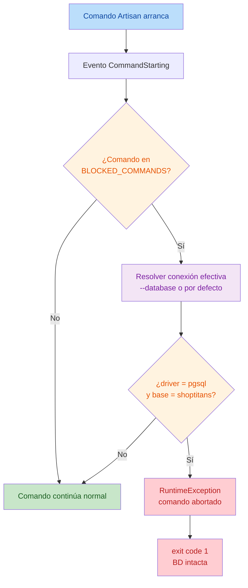

# Reporte Técnico — Formalización del aislamiento de PHPUnit y protección de PostgreSQL

**Fecha:** 2026-10-23
**Autor:** Editor IA
**Estado:** IMPLEMENTADA Y VALIDADA — PENDIENTE DE REVISIÓN HUMANA
**Decisiones aplicadas:** P-1, P-2 y P-3 (aprobadas por el usuario)

> **Restricciones respetadas.** No se ejecutaron migraciones, seeders, importadores, `migrate:fresh`, `migrate:refresh` ni `db:wipe`; no se escribió ni modificó nada en PostgreSQL; no se ejecutaron comandos destructivos; sin commit ni push. El aislamiento de PHPUnit ya validado (`AISLAMIENTO VERIFICADO`, 2026-10-23) se mantiene **intacto**.

## 1. Objetivo

Aplicar las decisiones aprobadas tras la verificación de aislamiento de PHPUnit del 2026-10-23:

- **P-1:** conservar el bloque `<server>` de `src/phpunit.xml`.
- **P-2:** documentar que el aislamiento depende de `force="true"` junto con `<server>`, no de `--env=testing`.
- **P-3:** implementar una protección contra `migrate:fresh`, `migrate:refresh` y `db:wipe` dirigidos a la base de desarrollo `shoptitans` cuando `APP_ENV=local`.

## 2. Alcance

**Incluye:** inspección de la documentación; identificación del mecanismo menos invasivo para P-3 y su impacto en los comandos de Laravel y el entorno Docker; implementación de la guarda; documentación de las decisiones aprobadas; validaciones seguras.

**Excluye:** H-1..H-4 de la revisión independiente; `CraftingMaterialSeeder` en `DatabaseSeeder`; cambios en `phpunit.xml`; cualquier escritura en PostgreSQL; validación mediante ejecución real de los comandos destructivos (prohibido en esta tarea).

## 3. Estado inicial

- `src/phpunit.xml` contiene `force="true"` en `<env>` y el bloque `<server>` (`DB_CONNECTION=sqlite`, `DB_DATABASE=:memory:`, `DB_URL=""`), verificado como mecanismo de aislamiento en `docs/reports/2026-10-23_verificacion_aislamiento_phpunit.md`.
- No existe ninguna guarda para comandos manuales destructivos (riesgo R-3 del informe de aislamiento).
- Entorno Docker: contenedor `shoptitans-app` (`working_dir=/var/www/html`, monta `./src`), `shoptitans-postgres` (postgres:17). `.env` → `APP_ENV=local`, `DB_CONNECTION=pgsql`, `DB_DATABASE=shoptitans`; sin caché de configuración.
- `src/bootstrap/app.php` sin providers adicionales; `AppServiceProvider` vacío (`boot()` sin lógica).

## 4. Archivos creados y modificados

| Archivo | Acción | Motivo |
|---|---|---|
| `src/app/Console/DestructiveCommandGuard.php` | **Creado** | Guarda P-3 (listener de `CommandStarting`) |
| `src/app/Providers/AppServiceProvider.php` | **Modificado** | Registrar el listener |
| `src/tests/Unit/DestructiveCommandGuardTest.php` | **Creado** | Pruebas de la guarda |
| `PROJECT_CONTEXT.md` | **Modificado** | Registrar las decisiones aprobadas P-1/P-2/P-3 |
| `CHANGELOG.md` | **Modificado** | Alta de la guarda (cambio aprobado/integrado) |
| `AI_WORK_LOG.md` | **Modificado** | Hito, estado de tareas y próximo paso |
| `docs/reports/2026-10-23_formalizacion_aislamiento_y_proteccion_postgresql.md` | **Creado** | Este reporte |

**`src/phpunit.xml` NO se modificó** (P-1 = conservar). No hubo commits ni cambios de Git.

## 5. Cambios realizados

### 5.1 P-1 — Conservar el bloque `<server>` (sin cambios)
No se tocó `src/phpunit.xml`. El bloque `<server>` se mantiene como el elemento que sobrescribe `$_SERVER` y garantiza el aislamiento en el modo `--env=testing`.

### 5.2 P-2 — Documentar el aislamiento real
Se documentó explícitamente (en `PROJECT_CONTEXT.md`, `AI_WORK_LOG.md` y este informe) que el aislamiento depende de **`force="true"` en `<env>` + el bloque `<server>`**, y **no** del flag `--env=testing` por sí solo: el entorno heredado propaga `DB_CONNECTION=pgsql` vía `putenv` desde `.env`, por lo que `--env=testing` no limpia el entorno.

### 5.3 P-3 — Protección contra comandos destructivos

**Mecanismo elegido: listener del evento `Illuminate\Console\Events\CommandStarting`** (`src/app/Console/DestructiveCommandGuard.php`), registrado con `Event::listen(...)` en `AppServiceProvider::boot()`.

**Alternativas evaluadas y descartadas (por ser más invasivas o inefectivas):**

| Alternativa | Motivo del descarte |
|---|---|
| Sobrescribir las clases de comando del framework (`migrate:fresh`, `db:wipe`) | Duplica lógica del framework y depende de `confirmable`; frágil ante actualizaciones |
| Extender `ConfirmableTrait` | Solo actúa en `APP_ENV=production`; no cubre `local` |
| Modificar `config/database.php` con una guarda de conexión | No es consciente del comando; afectaría operaciones legítimas |
| Separar `.env` local con un nombre de BD distinto | No protege realmente; cambio de configuración amplio |
| **Listener de `CommandStarting`** (elegido) | Sin cambios en `vendor`, sin duplicar comandos, una sola línea de registro, no altera comandos legítimos |

**Lógica (condiciones de bloqueo):**

1. El nombre del comando está en `['migrate:fresh', 'migrate:refresh', 'db:wipe']`.
2. La **conexión efectiva** — la opción `--database` si se indicó, o `config('database.default')` en su defecto — resuelve a **driver `pgsql`** y **base de datos `shoptitans`** (`DestructiveCommandGuard::PROTECTED_DATABASES`).

Si ambas se cumplen, lanza `Symfony\Component\Console\Exception\RuntimeException`; el `Kernel` lo captura y devuelve **exit code 1** antes de que el comando toque la base de datos. En cualquier otro caso el listener no interviene.

**Nota de diseño:** la protección se basa en la **conexión efectiva** (driver + nombre) en lugar de `APP_ENV`. Es estrictamente más segura y además necesaria: en el entorno real la conexión `sqlite` comparte el nombre `shoptitans` (por `DB_DATABASE`), de modo que filtrar solo por nombre bloquearía SQLite; y en `--env=testing` `APP_ENV` resuelve a `local`, por lo que filtrar por `APP_ENV` no aportaría aislamiento adicional.



## 6. Hipótesis verificadas

| Hipótesis | Evidencia | Resultado |
|---|---|---|
| El listener se registra en el arranque real de la consola | Sonda de solo lectura: `listener_registered = true` | **Confirmada** |
| En el entorno real la conexión por defecto es pgsql/`shoptitans` | Sonda: `app_env=local`, `default_connection=pgsql`, `pgsql_driver=pgsql`, `pgsql_database=shoptitans` | **Confirmada** |
| La guarda decide "bloquear" para la conexión por defecto real | Sonda: `guard_blocks_default = true` | **Confirmada** |
| El despacho real del evento bloquea los tres comandos y no otros | Despacho del evento (sin ejecutar comandos): `migrate → ALLOWED`; `migrate:fresh`/`migrate:refresh`/`db:wipe → BLOCKED (RuntimeException)` | **Confirmada** |
| La guarda no interfiere con PHPUnit (SQLite `:memory:`) | `RefreshDatabase` ejecuta `migrate:fresh` interno sobre SQLite y la suite pasa (`BlueprintApiTest` 18 passed) | **Confirmada** |
| La guarda no rompe el arranque normal de la consola | `php artisan --version` → `Laravel Framework 13.22.0` | **Confirmada** |

## 7. Discrepancias

| # | Estado documentado | Estado real | Evidencia | Impacto | Propuesta |
|---|---|---|---|---|---|
| D-P3-1 | La protección se describe "cuando `APP_ENV=local`" | Se implementó por **conexión efectiva** (driver + base), no por `APP_ENV` | En `--env=testing` `APP_ENV` resuelve `local` (informe de aislamiento §6); y la conexión `sqlite` comparte el nombre `shoptitans` (sonda) | Ninguno (la variante elegida es un superconjunto seguro del criterio pedido) | N/A — documentado aquí |

## 8. Decisiones

### Propuestas
- Ninguna nueva.

### Aprobadas (por el usuario, aplicadas en esta tarea)
- **P-1:** conservar el bloque `<server>` de `src/phpunit.xml`.
- **P-2:** documentar que el aislamiento depende de `force="true"` + `<server>`, no de `--env=testing`.
- **P-3:** protección contra `migrate:fresh`, `migrate:refresh` y `db:wipe` contra `shoptitans` (pgsql).

### Reemplazadas/Rechazadas
- Ninguna.

## 9. Validaciones ejecutadas

Todas `exit=0`. Ninguna conectó ni escribió en PostgreSQL.

### 9.1 Sintaxis y estilo
```bash
docker compose exec -T app sh -lc 'php -l app/Console/DestructiveCommandGuard.php && \
  php -l app/Providers/AppServiceProvider.php && php -l tests/Unit/DestructiveCommandGuardTest.php'
# No syntax errors detected (×3)

docker compose exec -T app vendor/bin/pint --test \
  app/Console/DestructiveCommandGuard.php app/Providers/AppServiceProvider.php tests/Unit/DestructiveCommandGuardTest.php
# PASS (3 files)
```

### 9.2 Pruebas de la guarda
```bash
docker compose exec -T app php artisan test --filter=DestructiveCommandGuardTest
# Tests: 6 passed (14 assertions)
```
Cubre: bloqueo de los tres comandos contra la conexión protegida; bloqueo cuando la conexión por defecto es la protegida; no bloqueo de `migrate`; no bloqueo de pgsql con otra base; no bloqueo de SQLite; y la detección `targetsProtectedDatabase()` para `null`/`''`/inexistente.

### 9.3 No interferencia con el aislamiento de PHPUnit
```bash
docker compose exec -T app php artisan test --filter=BlueprintApiTest
# Tests: 18 passed (155 assertions)
```
`RefreshDatabase` invoca internamente `migrate:fresh`; dado que la conexión es SQLite `:memory:`, la guarda **no** interviene (evidencia directa de no interferencia).

### 9.4 Sondas de solo lectura (sin conexión a BD)
```bash
docker compose exec -T app php -r '... bootstrap ...'
# {"app_env":"local","default_connection":"pgsql","pgsql_driver":"pgsql",
#  "pgsql_database":"shoptitans","sqlite_database":"shoptitans",
#  "listener_registered":true,"guard_blocks_default":true}
```

### 9.5 Despacho real del evento (sin ejecutar los comandos)
```bash
docker compose exec -T app php -r '... app("events")->dispatch(new CommandStarting($name, ...)) ...'
# migrate => ALLOWED
# migrate:fresh => BLOCKED (Symfony\Component\Console\Exception\RuntimeException)
# migrate:refresh => BLOCKED (Symfony\Component\Console\Exception\RuntimeException)
# db:wipe => BLOCKED (Symfony\Component\Console\Exception\RuntimeException)
```

### 9.6 Arranque normal de la consola
```bash
docker compose exec -T app php artisan --version
# Laravel Framework 13.22.0
```

### 9.7 Comprobaciones NO ejecutadas (por restricción explícita)
- **No** se invocó realmente `migrate:fresh`, `migrate:refresh` ni `db:wipe` (prohibido). Por tanto, la intercepción en una ejecución real se infiere del despacho real del evento (§9.5) más la resolución real de configuración (§9.4), no de una ejecución destructiva.
- No se ejecutó la suite completa (innecesario: el alcance no toca la API).

## 10. Resultado

- **P-1:** aplicada — `phpunit.xml` sin cambios.
- **P-2:** aplicada — aislamiento documentado como `force="true"` + `<server>`.
- **P-3:** implementada y validada — guarda activa que bloquea los tres comandos contra `pgsql`/`shoptitans` con exit code 1, sin afectar a comandos legítimos ni al aislamiento de PHPUnit.

## 11. Riesgos residuales

| # | Riesgo | Mitigación / Estado |
|---|---|---|
| R-1 | La guarda no cubre `migrate:reset`, `migrate:rollback` ni `db:seed` (fuera del alcance aprobado) | Documentado; ampliable si se aprueba |
| R-2 | Los nombres protegidos están en código (`PROTECTED_DATABASES`); un cambio de nombre de BD requeriría actualizar la constante | Documentado; valor por defecto del proyecto |
| R-3 | Intercepción no validada mediante ejecución real de los comandos | Inferida de evidencia equivalente (despacho real + config real); ejecución real prohibida en esta tarea |
| R-4 | Si desaparece el registro del listener en `AppServiceProvider::boot()`, la protección se pierde | Cubierto por `DestructiveCommandGuardTest` a nivel de clase; el registro se verifica en §9.4 |

## 12. Pendientes

- **Revisión humana** de este informe.
- Decidir si `CraftingMaterialSeeder` se añade a `DatabaseSeeder` (sin cambios aquí).
- Decidir si se abordan H-1..H-4 (revisión independiente de la API; sin cambios aquí).
- Autorizar (si se desea) una prueba end-to-end de la guarda invocando realmente un comando destructivo contra un destino desechable.

## 13. Preguntas para ChatGPT

1. ¿Se desea ampliar la guarda a `migrate:reset` / `migrate:rollback` / `db:seed`?
2. ¿Se prefiere externalizar los nombres protegidos a configuración (`config/`) en lugar de constantes?

## 14. Próximo paso

Detenerse y esperar revisión humana. No avanzar a las tareas pendientes (H-1..H-4, `CraftingMaterialSeeder`) sin aprobación explícita.
