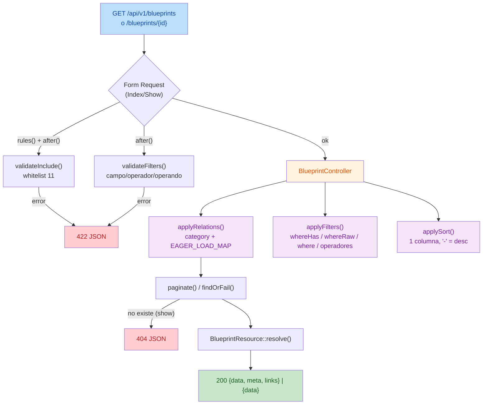

# Reporte Técnico — Revisión independiente de la API pública de Blueprints (Etapa 2)

**Fecha:** 2026-10-23
**Autor:** Editor IA (revisión independiente)
**Estado:** REVISIÓN COMPLETADA — **APROBADA CON OBSERVACIONES** (observaciones no bloqueantes)

> **Nota de alcance.** Esta revisión es de **solo lectura**. No se ejecutaron migraciones, seeders, importadores ni migraciones de esquema; no se escribió ni modificó ningún dato en PostgreSQL; no se realizaron cambios de código; no hubo commit ni push. La única ejecución fue la del subconjunto de pruebas `BlueprintApiTest`, aislado en SQLite `:memory:`.

## 1. Objetivo

Revisar de forma independiente la implementación de la API pública `/api/v1` de Blueprints contra el contrato aprobado (D-1..D-8) y los informes de correcciones previos, verificando:

1. Rutas, controlador, Form Requests y API Resource.
2. Filtros, operadores, ordenamiento, parámetros `include` y respuestas HTTP frente al contrato OpenAPI.
3. Validación de entradas, manejo de errores, consultas y posibles problemas N+1.
4. Confirmación de las correcciones **DP-1** (`available_as_antique`), **DP-2** (aislamiento de pruebas) y de la **regresión del `include` anidado**.
5. Ejecución de las pruebas pertinentes respetando el aislamiento de PHPUnit.

## 2. Alcance

**Incluye:** revisión estática de los archivos de la Etapa 2; contraste OpenAPI ↔ código (include, filtros, operadores, `sort`, parámetros y códigos de respuesta); verificación de DP-1/DP-2 y de la regresión del `include` anidado; ejecución del subconjunto `BlueprintApiTest`.

**Excluye:** cambios de código o de contrato; migraciones, seeders, importadores y cualquier escritura en PostgreSQL; ejecución de la suite completa; decisión sobre las propuestas P-1..P-3 y sobre añadir `CraftingMaterialSeeder` a `DatabaseSeeder`.

## 3. Estado inicial

- Etapa 2 **implementada** con la revisión correctiva DP-1/DP-2 y la revisión final (4 objetivos) aplicadas, según `AI_WORK_LOG.md`.
- Artefactos revisados: rutas, controlador, dos Form Requests, Request base, API Resource, modelo `Blueprint`, `bootstrap/app.php`, `phpunit.xml`, contrato OpenAPI y la suite `BlueprintApiTest`.

## 4. Archivos revisados (sin modificaciones)

| Archivo | Revisión |
|---|---|
| `src/routes/api.php` | Rutas `/v1` (index, show) |
| `src/app/Http/Controllers/Api/V1/BlueprintController.php` | Lógica de consulta, filtros, orden y formato de respuesta |
| `src/app/Http/Requests/BlueprintRequest.php` | Whitelist `include`, `EAGER_LOAD_MAP`, `includeList()`, `validateInclude()` |
| `src/app/Http/Requests/BlueprintIndexRequest.php` | `SORTABLE`, `FILTERS`, operadores, reglas y `validateFilters()` |
| `src/app/Http/Requests/BlueprintShowRequest.php` | Validación de `id`/`include` y `prepareForValidation()` |
| `src/app/Http/Resources/BlueprintResource.php` | Serialización de campos, `stats`, `energies` y relaciones `whenLoaded` |
| `src/app/Models/Blueprint.php` | `fillable`, `casts()` y relaciones |
| `src/bootstrap/app.php` | `shouldRenderJsonWhen` para `api/*` |
| `src/phpunit.xml` | `force="true"` + bloque `<server>` (aislamiento) |
| `src/tests/Feature/BlueprintApiTest.php` | 18 pruebas |
| `docs/openapi/blueprints-v1.yaml` | Contrato 3.0.3 (D-1..D-8) |

## 5. Diagrama de flujo (solicitud → respuesta)



## 6. Verificación de correspondencia OpenAPI ↔ código

| Aspecto | Contrato OpenAPI | Código | Resultado |
|---|---|---|---|
| Prefijo | `/api/v1` | `Route::prefix('v1')` | ✅ Coincide |
| Endpoints | `GET /blueprints`, `GET /blueprints/{id}` | idénticos | ✅ Coincide |
| `include` (whitelist) | 11 relaciones | `BlueprintRequest::INCLUDES` (11) | ✅ 11/11 |
| Filtros | 16 (`name`, `unlock_prerequisite`, `category`, `category_id`, `element`, `spirit_affinity`, `built_in_element`, `built_in_spirit`, `resource`, `worker`, `available_as_antique`, `tier`, `gold_value`, `craft_time_seconds`, `merchant_xp`, `airship_power`) | `BlueprintIndexRequest::FILTERS` (16) | ✅ 16/16 |
| Operadores numéricos | `eq`, `gt`, `gte`, `lt`, `lte` | `NUMERIC_OPERATORS` | ✅ Coincide |
| Operadores exactos | `eq` | `EXACT_OPERATORS` | ✅ Coincide |
| `sort` | 7 campos (`id`, `name`, `tier`, `gold_value`, `craft_time_seconds`, `merchant_xp`, `airship_power`), prefijo `-` | `SORTABLE` (7) + variantes con `-` | ✅ 7/7 |
| `page`/`per_page` | `per_page` por defecto 25, máx 100 (D-5) | `per_page` def. 25; reglas `min:1,max:100` | ✅ Coincide |
| `available_as_antique` | enum `true/false/1/0`; otros → 422 | `Rule::in(ANTIQUE_VALUES)` + `applyAntiqueFilter` | ✅ Coincide |
| Estructura de listado | `{data, meta, links}` | `resolve()` + `meta`/`links` del paginador | ✅ Coincide |
| Estructura de detalle | `{data}` | idéntico | ✅ Coincide |
| `meta` | `from`/`to` nullable | `firstItem()`/`lastItem()` | ✅ Coincide |
| Códigos de respuesta (index) | 200 / 422 / 500 | 200 / 422 (validación) / 500 | ✅ Coincide |
| Códigos de respuesta (show) | 200 / 404 / 422 / 500 | 200 / 404 (`findOrFail`) / 422 / 500 | ✅ Coincide |
| `category` | siempre presente (nullable) | `with('category')` + `whenLoaded` | ✅ Coincide |
| D-7 (exclusiones) | sin `raw_value`, ids de pivote ni timestamps | Resource no los expone | ✅ Coincide |
| D-8 (tipos) | enteros `int`, decimales `float` | `intOrNull` / `floatOrNull` (`decimal:4` → float) | ✅ Coincide |

**Correspondencia OpenAPI ↔ código: sin discrepancias de contrato.**

## 7. Verificación de DP-1, DP-2 y de la regresión del `include` anidado

### DP-1 — `filter[available_as_antique]`
- **Validación:** `BlueprintIndexRequest::valueRules('available_as_antique')` → `Rule::in(['true','false','1','0'])`; cualquier otro valor → `422` (incluido el operador `[gt]`, que no pertenece a la familia `exact`).
- **Aplicación:** `applyAntiqueFilter()` normaliza `true`/`1` → `whereNotNull('available_as_antique_at')` y `false`/`0` → `whereNull(...)`.
- **Evidencia de prueba:** `test_index_filters_by_available_as_antique` y `test_index_rejects_invalid_antique_values` (ambas PASS).
- **Resultado:** ✅ Confirmado.

### DP-2 — Aislamiento de PHPUnit (SQLite `:memory:`)
- **Mecanismo vigente:** `src/phpunit.xml` con `force="true"` en `<env>` **y** bloque `<server>` (variables `DB_CONNECTION=sqlite`, `DB_DATABASE=:memory:`, `DB_URL=""`).
- **Evidencia previa (no repetida aquí):** `docs/reports/2026-10-23_verificacion_aislamiento_phpunit.md` — aislamiento verificado en modo estándar y `--env=testing`, sin conexión a PostgreSQL.
- **Evidencia en esta revisión:** la ejecución de `BlueprintApiTest` finalizó con `exit=0` sin acceder a PostgreSQL (la suite usa `RefreshDatabase` sobre la conexión resuelta por `phpunit.xml`).
- **Resultado:** ✅ Confirmado (mecanismo inspeccionado; aislamiento verificado previamente).

### Regresión del `include` anidado
- **Causa corregida:** `includeList()` ahora descarta elementos no escalares (`! is_string($value) → continue`) antes de `trim()`, evitando el `TypeError` que producía el `500`; el rechazo queda delegado a la regla `'include' => ['sometimes','string']` → `422`.
- **Evidencia de prueba:** `test_include_rejects_nested_or_array_structures` — `include[workers][0]` en index y show, e `include[]` plano → `422` (PASS).
- **Resultado:** ✅ Confirmado.

## 8. Validación de entradas y manejo de errores

- **`include`:** validado contra la whitelist (`validateInclude`) → `422` si contiene una relación no permitida o una estructura no escalar.
- **`filter`:** `validateFilters()` rechaza campo no permitido, operador no permitido y operando inválido (usando un `Validator` interno por campo); los mensajes se añaden a `filter[...]` → `422`.
- **`sort`:** `Rule::in` sobre la lista permitida (con prefijo `-`) → `422`.
- **`page`/`per_page`:** `integer`, `min:1`, `max:100` → `422`.
- **`show`:** `id` `required|integer|min:1` (tomado de la ruta) → `422`; no encontrado → `404`.
- **Formato de error:** `shouldRenderJsonWhen(fn ($r) => $r->is('api/*'))` garantiza respuestas JSON para `404`/`422`/`500` en rutas de API.
- **Sin rutas de excepción no controladas detectadas** en el flujo de validación (estructuras anidadas de `filter` e `include` se rechazan con `422`, no con `500`).

## 9. Consultas y N+1

- `applyRelations()` carga `category` **siempre** y resuelve el resto según `EAGER_LOAD_MAP`; `elemental_affinities` se carga con `element` y `orderBy('position')` (evita N+1 y preserva el orden AZ).
- Los filtros por relación usan `whereHas`, no acceso a colecciones en PHP.
- **Evidencia de prueba:** `test_index_avoids_n_plus_one_queries` compara el número de consultas con 1 vs. 6 blueprints (relaciones adjuntas) y exige igualdad (PASS).
- **Resultado:** ✅ Sin N+1 en el listado con `include=workers,resources,components`.

## 10. Hallazgos

Clasificación por severidad. **Ninguno bloquea el contrato D-1..D-8; todos son observaciones no bloqueantes.**

### H-1 — Observación (severidad BAJA): interpolación del nombre de columna en SQL crudo
`BlueprintController::applyPartialMatch()` construye el fragmento `LOWER(<columna>) LIKE ?` concatenando `$column`. **No es explotable**: los únicos valores posibles provienen del `switch` de `applyFilter()` (`name`, `unlock_prerequisite`), literales del propio código. Es un patrón frágil ante refactorizaciones (si en el futuro `$column` derivara de entrada del usuario, habilitaría inyección). **No se propone cambio en esta revisión.** Evidencia: `src/app/Http/Controllers/Api/V1/BlueprintController.php` (`applyPartialMatch`).

### H-2 — Observación (severidad BAJA): ordenamiento sin desempate determinista
`applySort()` ordena por **una sola** columna. Con `sort=name` (u otras columnas no únicas), el orden entre filas empatadas no está garantizado, lo que puede producir duplicados/omisiones al paginar. El contrato **no** exige desempate y el valor por defecto `sort=id` es único. **No se propone cambio en esta revisión.** Evidencia: `src/app/Http/Controllers/Api/V1/BlueprintController.php` (`applySort`).

### H-3 — Observación (severidad INFORMATIVA): variante `[eq]` en filtros de texto
`filter[name][eq]` y `filter[unlock_prerequisite][eq]` son aceptados y se comportan igual que `filter[name]`/`filter[unlock_prerequisite]` (búsqueda parcial). Es coherente con D-6 (los campos de texto usan búsqueda parcial) y no contradice el contrato, aunque OpenAPI no enumera explícitamente esa variante.

### H-4 — Observación (severidad INFORMATIVA): `category_id` más estricto que el contrato
`valueRules('category_id')` exige `integer, min:1`, mientras OpenAPI declara solo `type: integer`. El código es **más restrictivo** (rechaza `0` y negativos). No es un defecto.

## 11. Validaciones ejecutadas

```bash
docker compose exec -T app php artisan test --filter=BlueprintApiTest
```

Resultado (exit code 0):

```text
PASS  Tests\Feature\BlueprintApiTest
  ✓ index returns paginated payload with default category
  ✓ index omits relations not requested and internal fields
  ✓ index paginates with per page and page
  ✓ index rejects invalid pagination
  ✓ index rejects disallowed sort and include
  ✓ include rejects nested or array structures
  ✓ index rejects disallowed filter field and operator
  ✓ index applies numeric operators and eq default
  ✓ index partial search is case insensitive
  ✓ index combines filters
  ✓ index filters by relations
  ✓ index filters by available as antique
  ✓ index rejects invalid antique values
  ✓ index sorts by allowed fields
  ✓ show returns blueprint with requested includes
  ✓ show returns 404 when missing
  ✓ show rejects invalid id and include
  ✓ index avoids n plus one queries

Tests:    18 passed (155 assertions)
Duration: 1.27s
```

**Comprobaciones NO ejecutadas en esta revisión** (para no repetir verificaciones ya concluidas o por estar fuera de alcance): reintento de la sonda de aislamiento de PHPUnit (concluida en `2026-10-23_verificacion_aislamiento_phpunit.md`); ejecución de la suite completa; verificación directa contra PostgreSQL (prohibida por las restricciones).

## 12. Resultado final

La implementación de la Etapa 2 (API pública `/api/v1` de Blueprints) **corresponde al contrato D-1..D-8** en rutas, parámetros, filtros, operadores, ordenamiento, `include`, estructura de respuesta y códigos HTTP. Las correcciones **DP-1**, **DP-2** y la **regresión del `include` anidado** quedan **confirmadas**. No se detectaron problemas de severidad media ni alta; los hallazgos son observaciones de severidad baja/informativa, no bloqueantes y sin impacto en el contrato.

### Veredicto

**APROBADA CON OBSERVACIONES** (H-1..H-4, todas no bloqueantes).

## 13. Riesgos

- **R-1 (bajo):** la fragilidad de H-1 solo se materializaría si `$column` dejara de ser un literal; hoy no lo es.
- **R-2 (bajo):** la inestabilidad de paginación de H-2 afecta únicamente a ordenamientos por columnas no únicas; el contrato no lo prohíbe.

## 14. Pendientes

- Decidir si se abordan las observaciones H-1..H-4 (ninguna requerida por el contrato).
- Conservar el respaldo `backups/shoptitans_pre_recuperacion_20261023_203355.dump` hasta el cierre del incidente de datos.

## 15. Preguntas para ChatGPT

1. ¿Se desea formalizar un desempate secundario por `id` en el ordenamiento (H-2) como mejora futura?
2. ¿Se documentará en OpenAPI la variante `[eq]` para los filtros de texto (H-3) o se considera innecesaria?

## 16. Próximo paso recomendado

Cerrar la revisión independiente de la Etapa 2 aceptando el veredicto **APROBADA CON OBSERVACIONES**. Las observaciones H-1..H-4 pueden quedar registradas sin cambios de código.

---

## 17. Addendum — Corrección de las observaciones H-1..H-4 (2026-10-23)

**Estado:** OBSERVACIONES H-1..H-4 **ATENDIDAS**. Cambios mínimos de código y de contrato, sin alterar el alcance funcional ni las decisiones D-1..D-8. No se ejecutaron migraciones, seeders, importadores ni operaciones destructivas; no se escribió en PostgreSQL (desarrollo); sin commit ni push.

### 17.1 Resolución por observación

| # | Severidad | Manifestación verificada | Corrección aplicada | Archivo |
|---|---|---|---|---|
| H-1 | BAJA | `applyPartialMatch()` usaba `whereRaw('LOWER('.$column.') LIKE ?', ...)`, concatenando el nombre de columna en SQL crudo | Se delega en `$query->whereLike($column, '%'.$value.'%', caseSensitive: false)`: el grammar cita el identificador y la insensibilidad a mayúsculas la resuelve el driver (`ilike` en PostgreSQL, `like` en SQLite). Sin concatenación de SQL | `src/app/Http/Controllers/Api/V1/BlueprintController.php` |
| H-2 | BAJA | `applySort()` ordenaba por una sola columna; sin desempate, la paginación podía duplicar/omitir filas empatadas | Se añade `orderBy('id')` como criterio secundario cuando la columna primaria no es `id` (el orden por defecto `id` no duplica el criterio) | `src/app/Http/Controllers/Api/V1/BlueprintController.php` |
| H-3 | INFORMATIVA | `filter[name][eq]` / `filter[unlock_prerequisite][eq]` se aceptaban (búsqueda parcial), pero OpenAPI no enumeraba la variante | Se documenta en `FilterName` y `FilterUnlockPrerequisite` que la variante `[eq]` se admite y equivale a la búsqueda parcial, conforme a D-6. **Sin cambio funcional** | `docs/openapi/blueprints-v1.yaml` |
| H-4 | INFORMATIVA | `valueRules('category_id')` exigía `integer, min:1` (más estricto que el contrato, que solo declaraba `type: integer`) | Se alinea el contrato añadiendo `minimum: 1` y la nota de `422` para `0`/negativos. **Sin cambio de código**; consistente con `BlueprintId` y `filter[tier]` | `docs/openapi/blueprints-v1.yaml` |

### 17.2 Criterio de corrección

- **H-1/H-2** se corrigen en código porque son defectos de implementación (patrón frágil / no determinismo), sin impacto en el contrato.
- **H-3/H-4** se resuelven **alineando el contrato OpenAPI al comportamiento ya implementado y revisado**, que es la opción mínima: cambiar el código (rechazar `[eq]` en texto, o relajar `min:1`) alteraría el alcance funcional aprobado. Los cambios no introducen operadores, filtros ni parámetros nuevos ni modifican D-1..D-8.

### 17.3 Evidencia en código

- `BlueprintController::applyPartialMatch()` usa `whereLike` (sin `whereRaw` ni interpolación).
- `BlueprintController::applySort()` emite un segundo `orderBy('id')` cuando `$column !== 'id'`.
- Test de regresión añadido: `test_index_sort_adds_deterministic_secondary_key` (inspecciona la cláusula `order by` real de SQLite).

### 17.4 Validaciones ejecutadas (aisladas en SQLite `:memory:`)

```bash
docker compose exec -T app php -l app/Http/Controllers/Api/V1/BlueprintController.php   # No syntax errors
docker compose exec -T app php -l tests/Feature/BlueprintApiTest.php                     # No syntax errors
docker compose exec -T app vendor/bin/pint --test                                        # PASS (100 files)
docker compose exec -T app php artisan test --filter=BlueprintApiTest                    # 19 passed (160 assertions)
```

Resultado: `exit=0` en todas. La prueba previa de búsqueda parcial insensible a mayúsculas (`test_index_partial_search_is_case_insensitive`) sigue pasando, confirmando que `whereLike` preserva la semántica de H-1.

### 17.5 Puntos que requieren aprobación humana

1. **H-3/H-4 (contrato OpenAPI):** se modificó `docs/openapi/blueprints-v1.yaml` para documentar comportamiento ya implementado. Es un cambio de **documentación de contrato** (no de alcance); se registra aquí para aprobación explícita.
2. **H-2 (desempate):** se eligió `id` ascendente como criterio secundario fijo, independientemente de la dirección del orden primario. Si se prefiere que el desempate siga la misma dirección (`desc` en `sort=-campo`), debe indicarse.

### 17.6 Veredicto tras el addendum

Con H-1..H-4 atendidas, la implementación de la Etapa 2 pasa a **APROBADA** (sin observaciones pendientes de corrección), a reserva de la aprobación humana de los puntos de §17.5.

## 18. Addendum — Aprobación humana de H-2/H-3/H-4 (2026-10-24)

**Estado:** los dos puntos de §17.5 quedan **APROBADOS** por el usuario el **2026-10-24**. Este addendum es un registro **aditivo**; no se reescribe el historial de §17.

| Punto de §17.5 | Decisión aprobada |
|---|---|
| **H-3/H-4 — documentación del contrato OpenAPI** | Aprobado: `filter[campo][eq]` documentado como coincidencia parcial y `category_id` con `minimum: 1` en `docs/openapi/blueprints-v1.yaml` (alineación al comportamiento implementado; sin cambio de alcance). |
| **H-2 — criterio de desempate** | Aprobado: desempate determinista por **`id` ascendente fijo** como criterio secundario en `applySort()`, independientemente de la dirección del orden primario. |

Con ello, H-1..H-4 quedan **CORREGIDAS (2026-10-23) y APROBADAS (2026-10-24)**; **no quedan decisiones pendientes de aprobación** sobre ellas. La reconciliación documental se registró en `AI_WORK_LOG.md` el 2026-10-26 (ver `docs/reports/2026-10-26_reconciliacion_estado_h2_h3_h4.md`).

